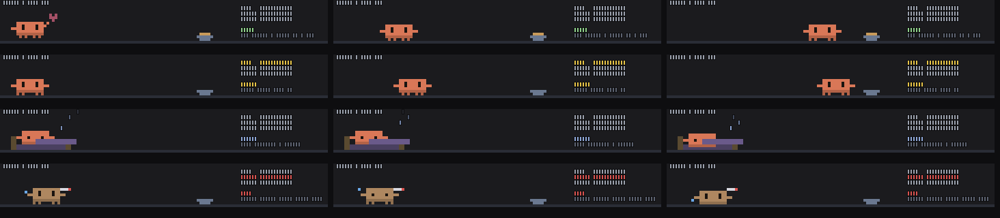

# clawd-pet

A Claude Code mod. Clawd as a pet above the prompt: turns that finish without a failed tool call feed it, failed calls make it sick, long sessions make it sleepy. Kept across sessions. /clawd-pet shows or hides it; /clawd-pet status.



*Preview frames rendered from the mod's own drawing code.*

**It won't use any of your usage.** Everything is drawn locally from code: no model calls, no tokens.

## Install

```
/plugin marketplace add saiharsha03/clawd-pet
/plugin install clawd-pet@clawd-pet
```

Or from a clone: `claude --plugin-dir ./clawd-pet`.

## Where it shows

In the band above the prompt, hidden until `/clawd-pet`. Terminal only.

## Commands

- `/clawd-pet`

## What the hooks do

`hooks/register.tsx` hooks: session.start, command.run{command=clawd-pet}, turn.start, tool.call, turn.complete, ui.render{component=AbovePrompt}. It never blocks or rewrites a tool call or a prompt; it only watches them, draws, and answers its own commands.

## Privacy: what data it sends

None. It makes no network or model calls; anything it remembers stays in Claude Code's local plugin storage on your machine.

## Licence

MIT. Clawd is Anthropic's Claude Code mascot; this is an unofficial fan mod.
